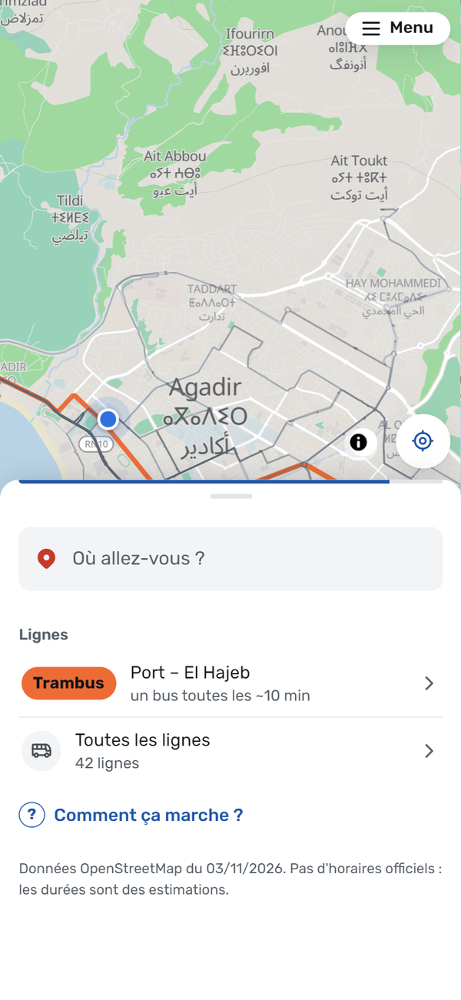
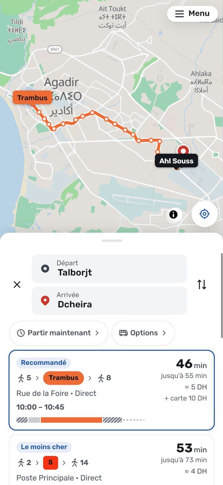
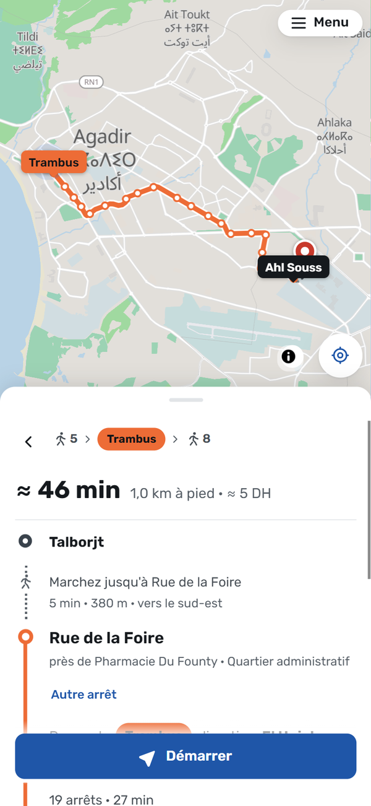
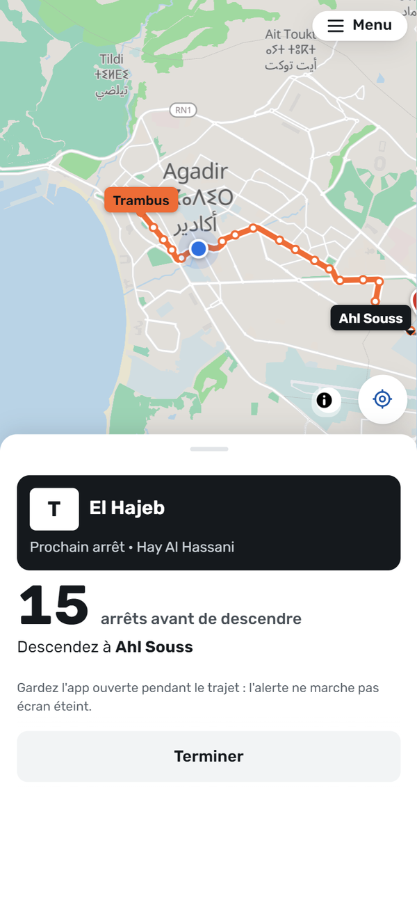
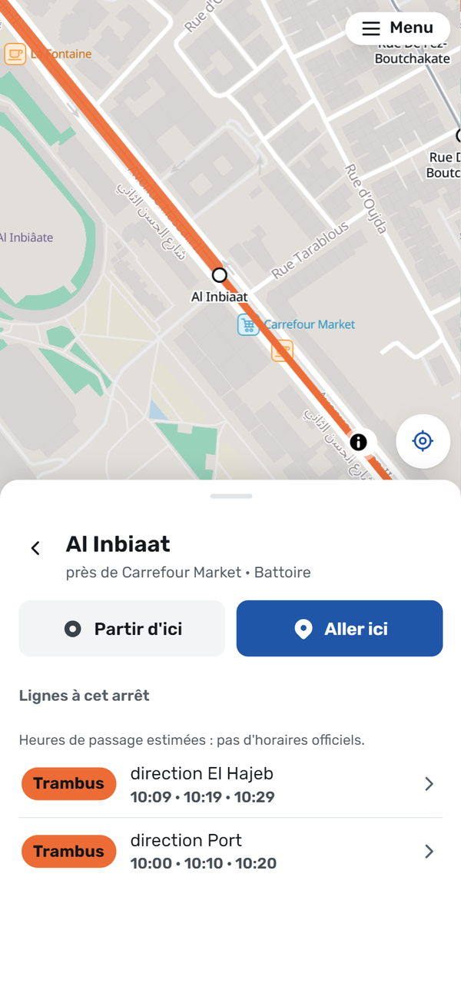
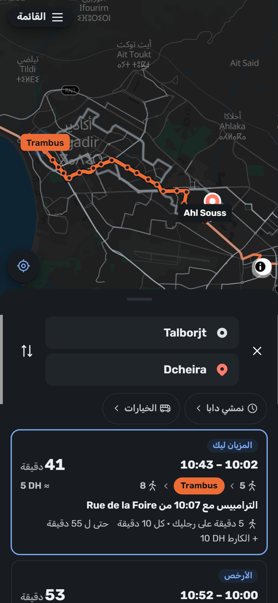

<p align="center">
  
</p>

<h1 align="center">Tobis</h1>

<p align="center">
  Bus and Trambus trip planner for Greater Agadir. Works offline. French, Darija and English.<br>
  <a href="https://tobis.pages.dev"><b>tobis.pages.dev</b></a>
</p>

<p align="center">
  <a href="https://github.com/zkousama/tobis/actions/workflows/deploy.yml"></a>
  <a href="LICENSE"></a>
</p>

<table align="center">
  <tr>
    <td align="center"><br><sub>Where to?</sub></td>
    <td align="center"><br><sub>Every way there, compared</sub></td>
    <td align="center"><br><sub>Where to get on and off</sub></td>
  </tr>
  <tr>
    <td align="center"><br><sub>Counts the stops on the way</sub></td>
    <td align="center"><br><sub>Next passages at a stop</sub></td>
    <td align="center"><br><sub>Darija, dark mode</sub></td>
  </tr>
</table>

A couple of months ago Google Maps stopped showing Agadir's buses. You'd ask for a route and get driving or walking, and the bus lines were gone from the map. I take these buses, so I built my own planner. Tobis is Darija for bus.

It's a web app you can add to your home screen, and once it has loaded it works with no signal.

## Put it on your phone

Open [tobis.pages.dev](https://tobis.pages.dev), then:

- **iPhone (Safari):** Share, then *Add to Home Screen*. Open it once with signal so it saves the map and lines.
- **Android (Chrome):** the app offers *Installer* after your first trip; it's also in *Menu*, under *Installer l'app sur le téléphone*.

It updates itself the next time it opens with signal.

## What it does

- Tells you which bus or Trambus to take, where to wait for it, how many stops to ride, where to get off and how far you'll walk.
- Compares every way to get there (bus combinations, the Trambus, walking, and the fixed-fare taxi from the airport) on time, price and walking, and recommends one. In Options you set what a saved hour is worth to you, prefer fewer changes or less walking, turn buses or the Trambus off and leave out lines you don't want; the ranking also adjusts to the trips you pick.
- Leave now, leave at a time or arrive by a time, any day. With no official timetables these are estimates, and the Trambus isn't offered before its 6:00 start.
- Walk to the stop you choose, or get off where you want. When no bus is close by, it looks further and says how far the first stop is.
- Each stop lists its lines, with the Trambus's next passages (estimated from its first departure and frequency).
- Remembers the trips you make often and puts them on the home screen.
- Finds neighbourhoods, streets, stops, pharmacies, clinics and shops offline, misspellings included. For a place it doesn't know, share or paste a Google Maps link, or type a plus code.
- Ride mode follows you along the line with GPS, counts the stops left and buzzes before yours.
- Says when a trip needs the Trambus card (10 DH the first time, then you top it up), and can leave the Trambus out.
- Light and dark themes, large text, and right-to-left in Darija.

## How it works

- **Route finder**: a round-based search (like RAPTOR) over every line and direction, with up to two changes. There are no official timetables for most lines, so waits and ride times are estimates: the Trambus runs every 10 minutes, and ride time comes from the distance between stops.
- **Walking**: real street distances and paths from a compact street graph shipped with the app (`public/data/agadir-walk.bin`).
- **Map**: a vector map of Greater Agadir cut out of the Protomaps world build (`public/basemap/agadir.pmtiles`), read in pieces from the offline cache.
- **Ride mode**: GPS only, so it works offline too. It keeps the screen on while you ride.
- **Search**: a prefix and typo-tolerant index built on the phone. Short `maps.app.goo.gl` links are opened by `functions/api/expand.js`, a Cloudflare Pages Function, so they need a connection.

## Data

| What | Source | Licence |
|---|---|---|
| Lines, stop order, fares | ALSA Agadir, the public data behind alsa.ma/fr/agadir (`scripts/fetch-alsa.mjs`) | © ALSA, used as published |
| Trambus stations, frequency, fare | beta.amalway.ma, stations as mapped in OpenStreetMap | © Amalway / ODbL |
| Streets, stops, places | OpenStreetMap | ODbL 1.0 |
| More places (shops, clinics, offices) | Overture Maps, places theme | CDLA-Permissive-2.0 |
| Base map | Protomaps daily build, from OpenStreetMap | ODbL 1.0 |
| Icons | Tabler Icons | MIT |

### When the sources disagree: the data council

No single source is right. ALSA's site still listed line 22 months after the Trambus replaced it, launch coverage said the Trambus ran every 5 minutes where Amalway now says 10, and riders know about a new terminus before any feed does. So every fact (a line runs, its fare, how often it comes, where it ends) is a claim with a source, a date and a link, and `scripts/council.mjs` decides between them:

- **Trust tiers:** an operator announcement (a post on the operator's page, a communiqué) outranks the operator's site, which outranks OpenStreetMap and the press, which outrank a rider.
- **A feed that never changed isn't newer evidence:** an announced change beats a site still showing the old state, unless the site changed that fact after the announcement.
- **Riders alone never change the data:** one report shows in the app as "unconfirmed", with who reported it and when, and applies once a credible source agrees.
- **A change without a value** ("fares went up", amounts unknown) is watched, not shown.

Feeds give claims automatically; announcements, press and rider reports go in [`data/council/claims.json`](data/council/claims.json), each with its link. Operator posts (the Facebook page has no open feed) go through an inbox: drop an export of the page's posts (JSON with each post's text, link, date and pictures), screenshots or a post's text into `data/council/inbox/` and run `bun run council:inbox`. It skips posts the claims already cite, finds the lines, stops, dates and prices the others mention, and writes a draft per post with its link and pictures. Fare grids and maps are pictures, so a person reads them and fills in what the draft can't, then `node scripts/inbox.mjs --approve <draft>` adds it; drafts with anything left to fill are refused. Posts with nothing for the data (a night service for a match, a student card) are set aside with `--ignore <draft> "why"`, so they don't come back. An announced route change shows in the app as announced, with a note that the drawn route isn't updated yet, until its new end stop is on the line. New lines the operator announced that aren't mapped yet are listed at the end of the report. Every build publishes the verdicts, reasons and dissent in [`data/reports/council.md`](data/reports/council.md). In the app, each line says what its data rests on and links to a [correction form](https://github.com/zkousama/tobis/issues/new?template=data-correction.yml) that asks for the source.

The built data in `public/data/` is a derived database of OpenStreetMap and is available under the ODbL.

Where OpenStreetMap's bus routes are incomplete, the build says so in `data/reports/agadir.json`, and `scripts/osm-draft-trambus.mjs` writes a JOSM file that fills in the Trambus routes for review and upload.

## Build

```sh
bun install
node scripts/fetch-osm.mjs agadir          # OpenStreetMap snapshot into data/raw/agadir/
node scripts/fetch-alsa.mjs                 # ALSA lines and fares
overturemaps download --bbox=-9.95,29.92,-9.08,30.78 --type=place -f geojsonseq -o data/raw/agadir/overture/places.geojsonseq
node scripts/extract-basemap.mjs agadir 15  # offline map
node scripts/build-data.mjs agadir          # network, places, quality report
node scripts/build-walk.mjs agadir          # walking graph
bun run check                               # types, lint, tests
bun run build
```

`overturemaps` is the Overture Maps Python CLI (`pip install overturemaps`).

The screenshots above come from the built app in a real Chrome: `bun run screenshots` (with a local server and Chrome's debugging port open) retakes them into `docs/screenshots/`.

## Deploy

GitHub deploys it (`.github/workflows/deploy.yml`). Every push and pull request runs the checks, builds, and walks through every scenario in a headless Chrome, as a phone and as a desktop browser (`scripts/smoke.mjs`: search, links, trips, times, options, ride mode with a simulated GPS, settings, Darija, 200 % text, offline), with an accessibility check (axe, WCAG 2.2 AA) on each screen. A push to `master` then deploys tobis.pages.dev; "Run workflow" deploys the preview, preview.tobis.pages.dev.

The built data and map aren't in git. They go up as a GitHub release, and `data.lock.json` says which one a deploy uses (with its fingerprint). After rebuilding the data:

```sh
bun run data:pack    # packs public/data and the map, updates data.lock.json, prints the release command
```

Publish the release it prints, then commit `data.lock.json`.

The deploy needs 2 repository secrets: `CLOUDFLARE_API_TOKEN` (Cloudflare Pages: Edit) and `CLOUDFLARE_ACCOUNT_ID`. From a laptop, `bun run deploy:preview` and `bun run deploy:live` do the same checks and deploy directly.

A second workflow (`alsa-check.yml`) fetches ALSA's data every Monday and opens an issue when lines, stops, fares or timetables change, or when ALSA stops answering.

Installed copies pick up a new version the next time they open with signal. Only the files that changed are downloaded (`precache.json` lists a fingerprint per file). The new version takes over while the app is opening; if it's already in use, it shows a "new version" message and switches when tapped, so a page that's open never loses its files mid-trip. Settings shows the version, so a bug report can say which build it came from. The build fails if the offline copy grows past 30 MiB. `public/_headers` sets the security policy and keeps `sw.js` and `precache.json` uncached; a change to it is a new version too.

Other cities: add a `cities/<id>.json` with its bounding box and networks, and run the same scripts with that id.

## Grands taxis

Shared taxis have no published routes or fares, so they come from a list kept by hand: `data/taxis/agadir-grands-taxis.csv`. Each row is a stand (prefilled from OpenStreetMap) and one destination. Fill in `to` and `price_dh` (per seat); add `to_lat`/`to_lon` if the destination stand isn't the town centre; set `both_ways` to `no` for one-way routes. Rows without a price are left out. Rebuild with `node scripts/build-data.mjs agadir`.

Taxis: only the airport's fixed fares (published by ONDA) are shown. Petits taxis need Agadir's official meter tariff in `cities/agadir.json` (`petitTaxi`: start, perKm, minFare, night, nightFrom, nightTo) before the app shows them.

## Something wrong?

A stop in the wrong place, a line that changed, a place search can't find: [open an issue](https://github.com/zkousama/tobis/issues). Streets, stops and most places come from OpenStreetMap, so a fix made there reaches Tobis with the next data build.

## Licence

The code is MIT (see `LICENSE`). The data keeps the licences listed above.
